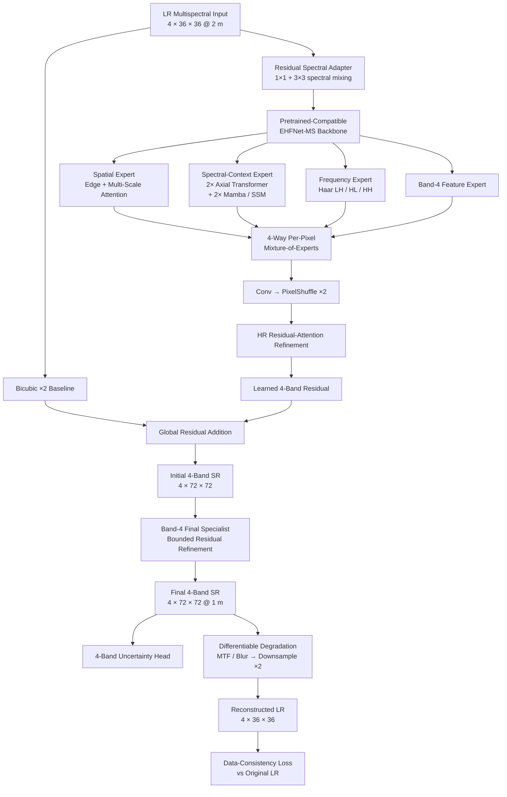
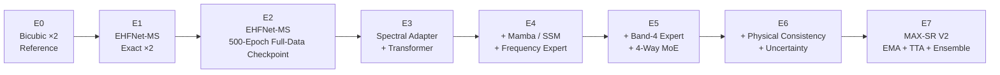
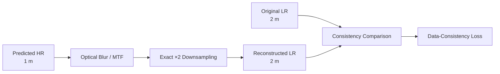
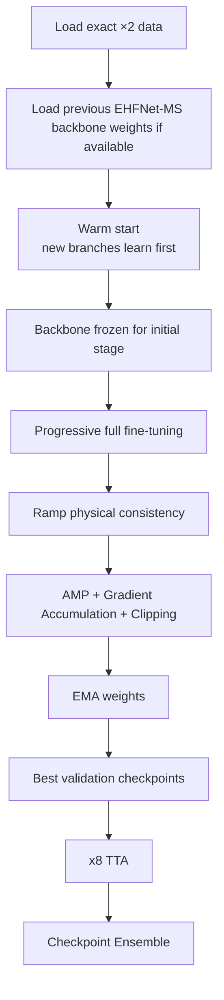

<div align="center">

# Multispectral Super-Resolution • 2 m → 1 m

### A physics-aware, maximum-performance framework for 4-band remote-sensing super-resolution

**Exact ×2 Super-Resolution · Spectral Fidelity · Frequency Recovery · Mixture-of-Experts · Physical Data Consistency**

<p>
  
  
  
  
</p>

<p>
  
  
  
  
</p>

</div>

---

## Overview

This project investigates **4-band multispectral super-resolution** for remote-sensing imagery, targeting an exact spatial enhancement from:

<div align="center">

| Input | Super-Resolution | Output |
|:---:|:---:|:---:|
| **4 × 36 × 36** | **×2** | **4 × 72 × 72** |
| **2.0 m / pixel** | → | **1.0 m / pixel** |
| 72 m × 72 m footprint | preserved | 72 m × 72 m footprint |

</div>

The goal is **not merely to generate a visually sharper image**. The model is designed to maximize spatial detail while preserving the multispectral signal, controlling Band-4 reconstruction, and enforcing consistency with the original low-resolution measurement.

> **Core idea:** reconstruct high-resolution spatial detail without sacrificing spectral fidelity or violating the measurement process that produced the low-resolution image.

---

## What makes this project different?

Most image super-resolution pipelines optimize primarily for spatial appearance. Multispectral remote sensing requires a stricter objective.

This framework jointly targets:

- **Spatial reconstruction** — edges, structures, and fine texture.
- **Spectral fidelity** — relationships between all four bands.
- **Band-specific accuracy** — dedicated modeling and loss terms for Band 4.
- **High-frequency recovery** — explicit wavelet/Haar high-frequency expert.
- **Long-range context** — Transformer + Mamba/SSM feature modeling.
- **Adaptive feature routing** — per-pixel 4-expert Mixture-of-Experts.
- **Physical consistency** — the predicted 1 m image must degrade back toward the original 2 m observation.
- **Maximum final performance** — EMA, best-checkpoint selection, x8 TTA, and checkpoint ensembling.

---

# Architecture



---

## Final model stack

| Stage | Component | Role |
|---|---|---|
| 1 | **Residual Spectral Adapter** | Performs early band mixing while preserving compatibility with pretrained features |
| 2 | **EHFNet-MS Backbone** | Main spatial feature extractor with edge enhancement and multi-scale attention |
| 3 | **Axial Transformer ×2** | Captures long-range spatial/spectral context at low resolution |
| 4 | **Mamba / SSM ×2** | Adds linear-cost long-range state-space modeling |
| 5 | **Haar Frequency Expert** | Explicitly models high-frequency LH/HL/HH content |
| 6 | **Band-4 Feature Expert** | Creates a dedicated feature representation for Band 4 |
| 7 | **4-Way MoE Fusion** | Learns spatially varying expert weights for each LR location |
| 8 | **PixelShuffle ×2** | Native learned upsampling from 36×36 to 72×72 |
| 9 | **HR Attention Refinement** | Refines high-resolution structures after upsampling |
| 10 | **Bicubic Global Residual** | Protects low-frequency/radiometric structure |
| 11 | **Band-4 Output Specialist** | Applies a bounded final residual correction to Band 4 |
| 12 | **Uncertainty Head** | Predicts per-band log-variance maps |
| 13 | **Differentiable Degradation** | Reconstructs LR for physical/data-consistency supervision |

---

# Model Evolution & Experiments

The project evolved from a strong exact-×2 EHFNet-MS baseline toward a composite maximum-performance architecture.



### Experiment / model registry

| ID | Model / Experiment | Main idea | Status |
|:--:|---|---|:--:|
| **E0** | Bicubic ×2 | Non-learned interpolation reference | Reference |
| **E1** | EHFNet-MS Exact ×2 | Edge-enhanced multispectral SR backbone | Developed |
| **E2** | EHFNet-MS Full-Data 500 ep | Previous exact-×2 trained checkpoint path supported by the new notebook | Checkpoint reuse supported |
| **E3** | Spectral-Context Extension | Residual spectral adapter + Transformer context | Integrated |
| **E4** | Hybrid Context + Frequency | Transformer + Mamba/SSM + Haar high-frequency expert | Integrated |
| **E5** | Expert Routing | Band-4 expert + 4-way per-pixel MoE | Integrated |
| **E6** | Physics-Aware SR | Uncertainty + differentiable degradation/data consistency | Integrated |
| **E7** | **MAX-SR V2 Composite** | Full architecture + EMA + best-checkpoint selection + x8 TTA + ensemble | **Current final implementation** |

> The current repository contains the implementation and training pipeline for **E7 / MAX-SR V2**. Final 1000-epoch benchmark numbers are intentionally not fabricated; they should be added after the full local run is completed.

---

# Training Objective

The full objective is a composite of reconstruction, spectral, spatial, uncertainty, expert-routing, and physical-consistency constraints.

\[
\mathcal{L}_{total}
=
\mathcal{L}_{pixel}
+
w_{b4}\mathcal{L}_{band4}
+
w_{sam}\mathcal{L}_{SAM}
+
w_{bias}\mathcal{L}_{bias}
+
w_{inter}\mathcal{L}_{interband}
+
w_{edge}\mathcal{L}_{edge}
+
w_{freq}\mathcal{L}_{frequency}
+
w_{dc}\mathcal{L}_{data-consistency}
+
w_{unc}\mathcal{L}_{uncertainty}
+
w_{gate}\mathcal{L}_{MoE}
\]

Optional NDVI supervision is available but **disabled by default** until the physical Red/NIR band identities are independently verified.

### Default loss weights

| Objective | Weight |
|---|---:|
| Band-4 Charbonnier | 1.50 |
| SAM | 0.10 |
| Band-4 Bias | 0.05 |
| Inter-band consistency | 0.05 |
| Edge | 0.05 |
| Frequency | 0.05 |
| Data consistency | 0.10 |
| Uncertainty | 0.02 |
| MoE balance | 0.003 |
| NDVI | 0.00 by default |

A bounded learnable controller can adjust these weights within a limited range without allowing the network to silently disable objectives.

---

# Physics-Aware Super-Resolution

The model is trained with a forward measurement constraint:



This is critical because a sharper image is not automatically a better multispectral reconstruction.

The current implementation uses an engineering MTF assumption:

```text
MTF @ Nyquist = 0.30
```

A measured sensor-specific MTF/PSF should replace this approximation when available.

---

# Training Strategy



### Default training configuration

| Setting | Value |
|---|---:|
| Epochs | **1000** |
| Batch size | **32** |
| Gradient accumulation | **2** |
| Effective batch | **64** |
| New-branch LR | **2e-4** |
| Backbone LR | **5e-5** |
| Backbone freeze | **10 epochs** |
| LR warmup | **10 epochs** |
| Scheduler | Warmup + Cosine |
| Gradient clipping | **1.0** |
| AMP | Enabled |
| EMA | **0.9995** |
| Auto-resume | Enabled |
| Periodic checkpoint | Every **25 epochs** |
| Final TTA | **x8** |
| Final checkpoint ensemble | Enabled |

---

# Evaluation

The project does not rely on a single image-quality metric.

### Spatial
- PSNR
- SSIM
- edge error
- high-frequency reconstruction error

### Pixel / Radiometric
- MAE
- RMSE
- Bias per band

### Band 4
- Band-4 MAE
- Band-4 RMSE
- Band-4 Bias
- Band-4 PSNR
- Band-4 SSIM

### Spectral
- SAM
- spectral correlation / inter-band consistency

### Physical
- degradation consistency error
- LR reconstruction error

---

## Results

Final MAX-SR V2 results should be inserted here after the full local training run.

| Model | PSNR ↑ | SSIM ↑ | SAM ↓ | RMSE ↓ | Band-4 RMSE ↓ | LR Consistency ↓ |
|---|---:|---:|---:|---:|---:|---:|
| Bicubic ×2 | — | — | — | — | — | — |
| EHFNet-MS exact ×2 | — | — | — | — | — | — |
| **MAX-SR V2** | **Pending full run** | **Pending** | **Pending** | **Pending** | **Pending** | **Pending** |

> No benchmark values are claimed in this repository snapshot until they have been produced by the actual training/evaluation run.

---

# Repository Structure

```text
.
├── README.md
├── requirements.txt
├── .gitignore
├── FILE_MANIFEST.json
│
├── configs/
│   └── maxsr_v2_default.json
│
├── notebooks/
│   └── GRAMM_MAXSR_V2_LOCAL_2m_to_1m.ipynb
│
├── docs/
│   ├── ARCHITECTURE.md
│   ├── PROJECT_STATUS.md
│   ├── TRAINING_GUIDE.md
│   ├── CHANGELOG.md
│   ├── GITHUB_UPLOAD.md
│   └── max_performance_composite_plan_ar.pdf
│
├── data/
│   ├── README.md
│   └── raw/
│
├── workspace/
├── checkpoints/
├── outputs/
└── scripts/
    ├── validate_notebook.py
    ├── run_jupyter.bat
    └── run_jupyter.sh
```

---

# Quick Start

## 1. Clone

```bash
git clone <your-repository-url>
cd <your-repository-name>
```

## 2. Create an environment

### Windows

```powershell
python -m venv .venv
.venv\Scripts\activate
python -m pip install --upgrade pip
```

### Linux / WSL

```bash
python3 -m venv .venv
source .venv/bin/activate
python -m pip install --upgrade pip
```

## 3. Install CUDA-enabled PyTorch

Install a PyTorch build compatible with the local NVIDIA driver/CUDA setup.

Then:

```bash
pip install -r requirements.txt
```

True `mamba-ssm` is optional. If unavailable, the notebook automatically switches to the included portable PyTorch SSM fallback.

## 4. Add data

Raw source location:

```text
data/raw/GRAMM.tif
```

If the prepared exact-×2 dataset already exists, place it under:

```text
workspace/EHFNet_MS_SR_x2_2m_to_1m/
```

## 5. Launch

```bash
jupyter lab
```

Open:

```text
notebooks/GRAMM_MAXSR_V2_LOCAL_2m_to_1m.ipynb
```

---

# Existing Checkpoint Reuse

The notebook searches for the previous exact-×2 EHFNet-MS checkpoint at:

```text
workspace/EHFNet_MS_SR_x2_2m_to_1m/
└── training/
    └── EHFNet_MS_x2_500ep_FULLDATA/
        └── checkpoints/
            ├── best_val_total.pt
            └── best_val_l1.pt
```

Only matching EHFNet backbone tensors are transferred into MAX-SR V2.

---

# Scientific Guardrails

- LR and GT must represent the **same geographic footprint**.
- Train/validation/test spatial separation must happen **before patch extraction**.
- Train-only normalization is used to prevent validation/test leakage.
- Band 4 is modeled specially, but its physical identity must be verified before using Band-specific vegetation indices.
- Sensor degradation assumptions must not be treated as measured physics unless actual MTF/PSF calibration is available.
- Visual sharpness alone is not accepted as evidence of successful multispectral SR.

---

# Current Project Status

<div align="center">

| Milestone | Status |
|---|:---:|
| Exact ×2 problem definition | ✅ |
| Leakage-safe dataset pipeline | ✅ |
| EHFNet-MS baseline architecture | ✅ |
| Previous checkpoint reuse | ✅ |
| Transformer + Mamba/SSM integration | ✅ |
| Frequency expert | ✅ |
| Band-4 specialist | ✅ |
| 4-way MoE | ✅ |
| Physics-aware consistency | ✅ |
| Uncertainty modeling | ✅ |
| EMA / TTA / ensemble pipeline | ✅ |
| Full runnable local notebook | ✅ |
| Notebook syntax validation | ✅ |
| Full 1000-epoch MAX-SR V2 run | ⏳ |
| Final benchmark table | ⏳ |
| Sensor-measured MTF/PSF | ⏳ |

</div>

---

# Primary Notebook

**`notebooks/GRAMM_MAXSR_V2_LOCAL_2m_to_1m.ipynb`**

This notebook is the canonical end-to-end implementation of the current project.

---

## Design Philosophy

> **Maximum reconstruction performance first.**  
> Architectural simplicity, minimal parameter count, and clean ablation attribution are secondary to achieving the strongest final multispectral SR result while maintaining spatial, spectral, and physical consistency.

---

<div align="center">

### Multispectral Super-Resolution • 2 m → 1 m

**EHFNet-MS · Transformer · Mamba/SSM · Frequency Modeling · MoE · Physics-Aware Consistency**

</div>
